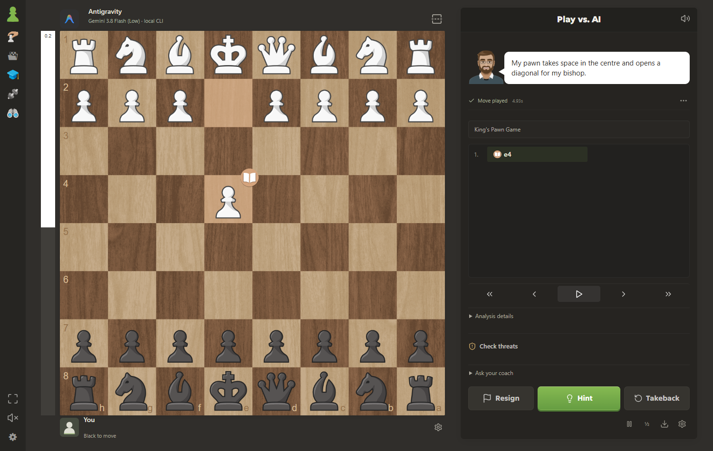

# Local Chess Coach

A Windows chess app with local Stockfish coaching, game review, offline puzzles, spoken feedback, and optional AI opponents.

## Download for Windows

**[Download the Windows installer](https://github.com/rafalou1/Local-Chess/releases/latest/download/LocalChessCoach-Windows-Setup.exe)**

1. Download `LocalChessCoach-Windows-Setup.exe`.
2. Run it and follow the setup wizard.
3. Open **Local Chess Coach** from your desktop or Start menu.

Windows 10/11, 64-bit Intel or AMD. No Git, Node.js, Rust, API key, or paid account is needed for local play. The installer includes Stockfish, voices, puzzles and the WebView2 installer. The download is about 458 MB because these resources are included for offline use.

[Installation help](docs/INSTALL.md) · [All releases and checksums](https://github.com/rafalou1/Local-Chess/releases) · [Report a problem](https://github.com/rafalou1/Local-Chess/issues)



## Play and learn

- Play against the local coach, another person on the same computer, or an AI provider.
- Review games, explore variations, and inspect legal alternatives with Stockfish 19.
- Practice with 10,800 offline puzzles, training from your mistakes, and spaced repetition.
- Use English/German coaching and optional spoken feedback.
- Click or drag pieces, queue premoves, choose promotions, and adjust board settings.
- Save games locally and import/export PGN.

## Optional AI opponents

Choose **AI provider** when starting a game, then choose **Codex**, **Claude Code**, or **Antigravity**. Missing provider tools have an Install button; sign-in takes place in the provider's official flow. The installed CLI supplies model and effort options.

The opponent receives the position, variant and legal moves after you accept the position-sharing checkbox. Stockfish still handles coaching, and the local chess rules validate every reply. Subscription/account limits apply; API authentication and automatic API billing fallback are blocked. Model access depends on your account and installed provider version. Connection failures show a Retry action, and Play explains any incomplete setup. Response times vary; lower effort can give faster replies.

During a game, open **Opponent options → View CLI response** to see and copy the assistant's actual answer that chose the move. The compact viewer contains no prompts or diagnostic metadata and lets you browse previous responses from the current app session.

Codex real moves were tested for v0.2.15. Antigravity startup and real moves were tested again for v0.2.17. Claude's catalog and unauthenticated setup were tested; signed-in Claude inference still needs real-account verification.

## Updates

Close the app, download the latest installer, and run it again. Normal installer updates preserve saved games and settings. [Data locations and backup instructions](docs/INSTALL.md#saved-games-and-backups).

## Build from source

On Windows, install Node.js 22+, Rust stable, and Visual Studio C++ Build Tools with the Windows SDK. Then:

```powershell
git clone https://github.com/rafalou1/Local-Chess.git
cd Local-Chess
npm ci
powershell -NoProfile -ExecutionPolicy Bypass -File scripts/Fetch-BuildResources.ps1
npm test
npm run build
npm run tauri build
```

The resource script downloads the pinned release archive and verifies SHA-256 before extracting it. Large runtime binaries/models and corresponding third-party sources are release assets, keeping the Git repository small. Development: `npm run tauri dev`. The installer is produced in `src-tauri/target/release/bundle/nsis/`.

## Licensing

Application source: **GPL-3.0-or-later**. Third-party engines, models, fonts, artwork and sounds retain their respective terms; see [third-party notices](THIRD_PARTY_NOTICE.md). The repository owner confirmed redistribution permission for the included reference assets. This is an independent application; it does not imply endorsement by Chess.com or the AI providers.
